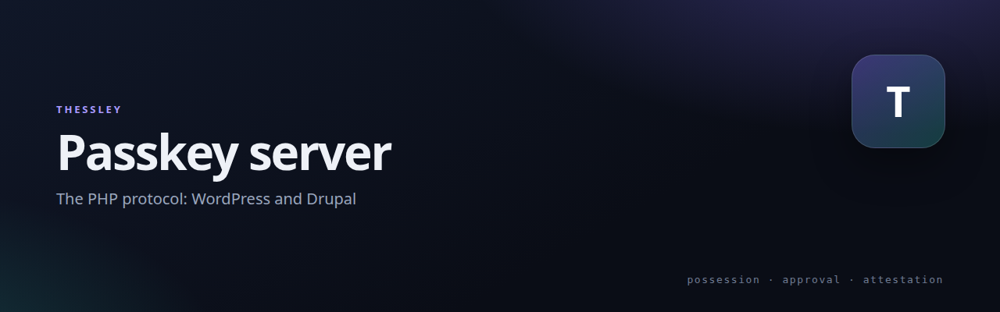

# Thessley Passkey — protocol reference

   

The wire protocol behind Thessley Passkey: how a site asks a phone to approve a
login, what the phone signs, and how the site verifies it. This repository is the
**specification and implementer notes** — the running code lives in the two
server repositories below.

**Presentation:** [interactive deck](https://netmate1234.github.io/thessley-passkey-server/)

## Implementations

| Server | Repository | Install |
| --- | --- | --- |
| WordPress | [`thessley-passkey-wordpress`](https://github.com/netmate1234/thessley-passkey-wordpress) | [`wp plugin install …`](https://github.com/netmate1234/thessley-passkey-wordpress#quick-install) |
| Drupal 10.6 / 11 | [`thessley-passkey-drupal`](https://github.com/netmate1234/thessley-passkey-drupal) | [copy the module folders](https://github.com/netmate1234/thessley-passkey-drupal#quick-install) |

Both speak the same wire format, so the same Android app and desktop approver
work with either.

## The protocol in short

- A request carries a type (`login` / `enroll`), id, nonce, origin and a 120-second life.
- The answer is ECDSA P-256 over a pipe-joined string: version, type, id, origin, nonce, time, action.
- The server verifies the enrolled public key, the timestamp (within 60 s) and the origin, then consumes the request exactly once.
- No shared secret is stored; the server keeps public keys only.

Read [`PROTOCOL.md`](PROTOCOL.md) for the exact fields, error codes and the
optional TPM 2.0 attestation step (vendor roots ship with each implementation).

## What is in this repository

| Path | What it is |
| --- | --- |
| `PROTOCOL.md` | The complete wire format — start here to build another client (e.g. iOS). |
| `docs/index.html` | The interactive deck served on GitHub Pages. |

## Building another client

1. Read `PROTOCOL.md` end to end; the version and domain-separation strings are fixed.
2. Implement the signed string exactly; a single separator difference fails verification.
3. Use the checks in the implementation repositories as your reference before pointing at a live site.
4. Never run the end-to-end checks against production.

## Related

- [Thessley](https://github.com/netmate1234/Thessley) — the project family and overview
- [thessley-passkey-wordpress](https://github.com/netmate1234/thessley-passkey-wordpress) — WordPress plugin
- [thessley-passkey-drupal](https://github.com/netmate1234/thessley-passkey-drupal) — Drupal modules
- [thessley-passkey-linux](https://github.com/netmate1234/thessley-passkey-linux) — desktop approver

## License

GPL-2.0-or-later.
